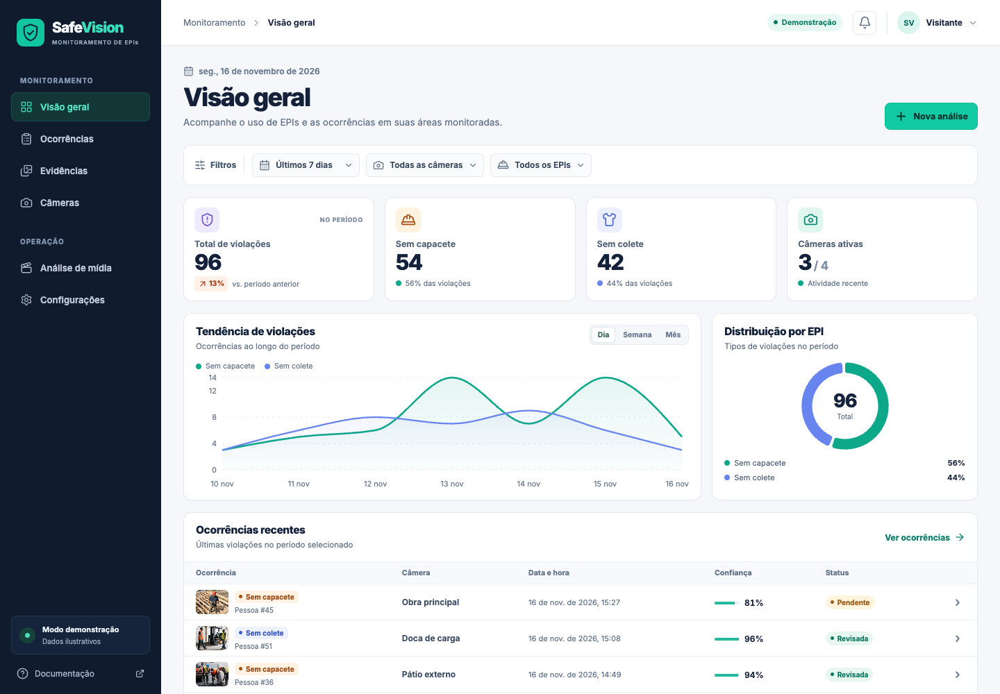
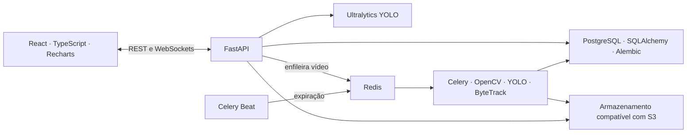

# SafeVision

O SafeVision analisa imagens, vídeos e webcams para localizar pessoas, capacetes e coletes de segurança. O sistema acompanha cada pessoa durante a análise, registra ausências persistentes e disponibiliza evidências para revisão humana.



[Captura do dashboard em celular](docs/dashboard-mobile.png)

## Executar

### Instalação com armazenamento e fila

Requer Docker com o plugin Compose e Python 3 para gerar as credenciais locais.

```bash
python3 scripts/init_env.py
docker compose up --build -d
```

Acesse [o dashboard local](http://127.0.0.1:7860/) e entre com `SAFEVISION_ADMIN_PASSWORD`, gravada em `.env`. Em **Nova análise**, tente uma das imagens prontas ou abra **Vídeo → Usar vídeo de exemplo**. Envie o vídeo para acompanhar o processamento e consultar a ocorrência gerada. O primeiro build baixa o checkpoint público.

A instalação usa PostgreSQL, Redis, Celery e um bucket privado. O Compose inclui RustFS como serviço local compatível com S3. A API usa o cliente S3 do boto3 e aceita outro endpoint compatível, incluindo MinIO. Para AWS S3, configure `SAFEVISION_S3_ENDPOINT=null` e use credenciais IAM e um bucket já provisionado. [Compatibilidade S3 do RustFS](https://docs.rustfs.com/en/reference/s3-compatibility)

### Demonstração sem banco ou fila

```bash
docker build -t safevision:demo .
docker run --rm -p 127.0.0.1:7861:7860 safevision:demo
```

Abra [a demonstração local](http://127.0.0.1:7861/). O dashboard usa dados ilustrativos identificados na interface. A análise de imagens e dos frames da webcam executa o checkpoint real. Os frames da webcam e as imagens enviadas são descartados após a resposta. O vídeo de exemplo fica disponível para reprodução. Use a instalação com Compose para rastreamento persistente, processamento assíncrono e evidências privadas.

### Desenvolvimento local

Requer Python 3.12–3.14 e Node 22.12+ ou 24 LTS.

```bash
python3 -m venv .venv
source .venv/bin/activate
pip install -e '.[test,onnx]'
python scripts/fetch_model.py
npm --prefix frontend ci
npm --prefix frontend run build
SAFEVISION_DEMO=true uvicorn safevision.api:app --port 7860 --ws-max-size 1048576
```

Para desenvolver a interface com atualização automática, inicie `npm --prefix frontend run dev` em outro terminal com a API ativa na porta 7860. A interface usa a mesma origem e o proxy do Vite para a API e os WebSockets.

## Arquitetura



- **Inferência.** A API retorna caixas `[x1, y1, x2, y2]` em pixels, classes, confiança e avaliações por pessoa. Capacetes são associados à região da cabeça e coletes à região do tronco. Cada detecção de EPI pode pertencer a uma pessoa. Conflitos e regiões cortadas ou ambíguas podem resultar em avaliação inconclusiva.
- **Vídeo e webcam.** ByteTrack mantém IDs temporários por vídeo ou sessão. O motor conta intervalos consecutivos de ausência observada e usa tolerância para breves perdas de detecção. Um evento é rearmado após recuperação estável. IDs determinísticos por vídeo, pessoa, EPI e episódio permitem reprocessar sem criar a mesma ocorrência novamente quando o rastreamento se repete.
- **Ocorrências.** A hora do evento é o horário de gravação mais a posição do frame que confirmou a regra. Sem data informada, usa-se o início do envio. A confiança é a do sinal visual registrado, limitada pela confiança da pessoa. Para ausência inferida sem detecção explícita de `no_helmet` ou `no_vest`, o valor é a confiança da detecção da pessoa. A evidência fica no bucket privado e o PostgreSQL armazena a referência.
- **Dashboard.** Série diária, semanal e mensal, distribuição por EPI, comparação entre câmeras, incidência por hora e galeria. Os filtros usam o fuso configurado, com padrão `America/Sao_Paulo`. Os indicadores contam ocorrências detectadas, incluindo revisadas e descartadas, e a interface oferece filtro por status. Câmeras ativas são as webcams que enviaram frames nos últimos dois minutos.

### Rotas principais

O contrato interativo está no [Swagger do servidor local](http://127.0.0.1:7860/docs). Os erros HTTP têm os campos `error.code`, `error.message` e `error.details`.

| Método | Rota | Função |
|---|---|---|
| POST | `/auth/login` | Abre sessão administrativa por cookie |
| POST | `/detect` | Analisa uma imagem multipart |
| POST | `/videos` | Enfileira um vídeo e retorna o ID do processamento |
| GET | `/videos/{id}/status` | Lê estado, progresso e erro do trabalho |
| POST | `/videos/{id}/retry` | Reenvia um trabalho falho com original disponível |
| GET | `/events` | Filtra por `start`, `end`, `camera_id`, `equipment` e `status` |
| GET / PATCH | `/events/{id}` | Exibe detalhes ou revisa o status |
| GET / DELETE | `/events/{id}/evidence` | Lê ou exclui a evidência |
| GET / POST | `/cameras` | Lista ou cadastra câmeras |
| GET | `/analytics/summary` | Agrega ocorrências, aceita `bucket=day\|week\|month` |
| WS | `/events/live` | Avisa sobre novas ocorrências |
| WS | `/cameras/{id}/live` | Recebe frames JPEG e retorna análise rastreada |
| GET | `/health` | Consulta dependências e contadores de inferência |

Exemplo com a demonstração na porta 7861:

```bash
curl -F 'file=@frontend/public/examples/doca.jpg;type=image/jpeg' http://127.0.0.1:7861/detect
curl 'http://127.0.0.1:7861/analytics/summary?equipment=helmet&bucket=week'
```

Na instalação completa, autentique-se no Swagger ou envie `{"password":"…"}` por `POST /auth/login` e preserve o cookie nas chamadas seguintes. Em `POST /videos`, envie `file`, `camera_id` e, opcionalmente, `recorded_at` em ISO 8601 com fuso. As câmeras podem ser cadastradas pela interface.

### Configuração operacional

| Variável | Padrão |
|---|---|
| `SAFEVISION_WEIGHTS` | `models/iaac-ppe.pt` |
| `SAFEVISION_DEVICE` / `SAFEVISION_TORCH_THREADS` | CPU / 2 |
| `SAFEVISION_IMAGE_SIZE` / `SAFEVISION_CONFIDENCE` | 640 / 0,35 |
| `SAFEVISION_SAMPLE_FPS` | 5 |
| `SAFEVISION_VIOLATION_SECONDS` | 2 s |
| `SAFEVISION_GAP_SECONDS` / `SAFEVISION_RECOVERY_SECONDS` | 0,8 s / 1 s |
| `SAFEVISION_IMAGE_MB` / `SAFEVISION_VIDEO_MB` | 8 MB / 100 MB |
| `SAFEVISION_MAX_VIDEO_SECONDS` | 300 s |
| `SAFEVISION_EVIDENCE_DAYS` / `SAFEVISION_UPLOAD_DAYS` | 30 / 2 |

## Modelo, avaliação e otimização

O checkpoint inicial é o YOLO26s ajustado pela equipe do curso AI Methods I do IAAC. O download fixa a revisão e confere SHA-256. A licença do checkpoint e do Ultralytics é **AGPL-3.0**. A licença Apache-2.0 do código do SafeVision se aplica ao código autoral. O dataset de origem do IAAC é Construction Site Safety, do Roboflow Universe, com licença **CC BY 4.0** conforme a ficha do checkpoint. [Ficha do modelo](https://huggingface.co/iaac-maai/day4-example-ppe-detector) · [Código e licença Ultralytics](https://github.com/ultralytics/ultralytics)

O experimento do SafeVision usa a edição de novembro de 2026 do **Ultralytics Construction-PPE**, CC BY 4.0. O script separa 80 imagens do treino oficial para desenvolvimento e reserva as 200 imagens da validação oficial para a comparação final. A avaliação usa as cinco classes em comum entre os checkpoints. Consulte a metodologia, as métricas por classe, a matriz de confusão e os tempos medidos em [Resultados](docs/RESULTADOS.md). As imagens e o vídeo de exemplo têm [créditos e licenças próprios](docs/ASSETS.md). [Dataset de avaliação](https://docs.ultralytics.com/datasets/detect/construction-ppe/)

## Testes

```bash
pip install -e '.[test]'
python -m pytest -q -m 'not integration'
npm --prefix frontend run build
```

Com o Compose em execução, rode o teste que autentica, envia o vídeo de exemplo e verifica Celery/Redis, PostgreSQL, WebSocket e leitura e exclusão da evidência no S3:

```bash
set -a
source .env
set +a
SAFEVISION_TEST_PASSWORD="$SAFEVISION_ADMIN_PASSWORD" python -m pytest -q -m integration
```

O teste de integração cria registros no banco da instalação apontada por `SAFEVISION_TEST_URL`.

## Privacidade e revisão

- A instalação completa exige senha administrativa e usa cookie `HttpOnly` com `SameSite=Strict`. O Compose expõe as portas na interface local. Para uso em rede, configure TLS em um proxy reverso e `SAFEVISION_COOKIE_SECURE=true`.
- O servidor valida tipo, assinatura, tamanho e dimensões dos arquivos. A API mantém os objetos privados e verifica a sessão para entregar ou excluir uma evidência. A auditoria registra ações como login, cadastro de câmera, reenvio, revisão e exclusão.
- O Celery Beat agenda a remoção de frames e vídeos expirados. A remoção de uma evidência preserva o registro da ocorrência. Em operação, defina a política para esses registros, backups e versões do bucket de acordo com a finalidade e o prazo de retenção definidos pela organização.
- Os IDs de rastreamento são locais à sessão. Reserve a decisão sobre cada ocorrência à avaliação humana. Antes de operar com imagens de trabalhadores, documente finalidade, base legal, prazos e transparência com o responsável pelo tratamento. [LGPD e direitos do titular](https://www.gov.br/pt-br/lgpd/lei-geral-de-protecao-de-dados-pessoais) · [Perguntas frequentes da ANPD](https://www.gov.br/anpd/pt-br/acesso-a-informacao/perguntas-frequentes)

## Publicar a demonstração no Hugging Face Spaces

Este README e o Dockerfile já declaram um Docker Space na porta 7860. Em uma conta com permissão para criar Docker Spaces, autentique o CLI e envie a árvore fonte:

```bash
hf auth login
hf repos create SUA_CONTA/safevision --type space --sdk docker --public --flavor cpu-basic
hf upload SUA_CONTA/safevision . . --repo-type space \
  --include 'README.md' 'LICENSE' 'Dockerfile' '.dockerignore' 'pyproject.toml' 'alembic.ini' \
  'safevision/**' 'scripts/**' 'migrations/**' 'frontend/**' 'docs/**' 'eval/**' \
  --exclude '**/node_modules/**' '**/dist/**' '**/__pycache__/**'
```

O Space abre no modo demonstração sem credenciais de banco ou armazenamento. Consulte a disponibilidade de Docker Spaces no plano da conta. [Configuração de Docker Spaces](https://huggingface.co/docs/hub/en/spaces-sdks-docker) · [CLI do Hugging Face Hub](https://huggingface.co/docs/huggingface_hub/en/package_reference/cli)
